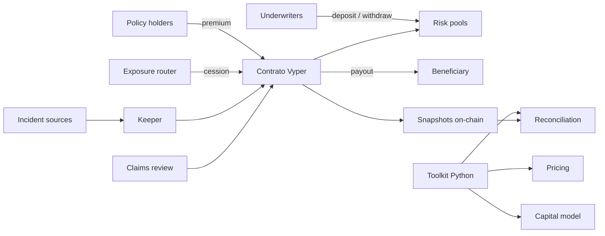
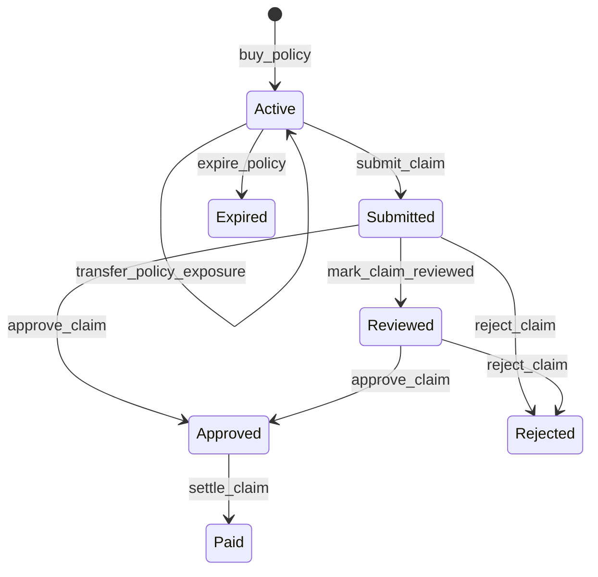

<h1 align="center">AegisInsuranceProtocol</h1>

<p align="center">
  <a href="https://github.com/SolguardLabs/AegisInsuranceProtocol/actions/workflows/ci.yml"></a>
  <a href="https://github.com/SolguardLabs/AegisInsuranceProtocol/releases"></a>
  
  
  <a href="./LICENSE"></a>
</p>

<p align="center">
  
</p>

Aegis es una infraestructura de cobertura DeFi para organizar capital de underwriters, productos
asegurables, pólizas, cesiones entre pools especializados y liquidación de claims. El contrato
Vyper conserva el estado económico y el paquete Python aporta pricing, revisión, reporting,
reconciliación y cálculo de capital bajo estrés.

La versión `1.0.0` fija una interfaz operativa estable, separación de funciones, circuit breaker,
límites de retención y capital, métricas de solvencia y un modelo actuarial determinista.

## Capacidades

- Pools segregados por sponsor, jurisdicción y política de utilización.
- Capital de underwriting representado mediante shares internas 1:1.
- Catálogo gobernado de productos, primas, deducibles y ventanas de claim.
- Distribución de exposición entre un pool originador y hasta cuatro cesionarios.
- Incidentes señalizados, evidencias, revisión y settlement multipartícipe.
- Roles independientes de reviewer, router, keeper y guardian.
- Pausa de emergencia con reanudación reservada al owner.
- Snapshots de utilización y solvencia por epoch.
- Pricing off-chain con observaciones de riesgo y ajustes de jurisdicción.
- Stress testing correlacionado y reconciliación por póliza, pool y subject.

## Arquitectura



La división evita introducir cálculos actuariales costosos en la EVM. El contrato aplica límites
discretos y settlement; los servicios calculan escenarios, detectan gaps y preparan decisiones.

## Modelo económico

La capacidad admisible de un pool es:

```text
capacityCeiling = totalCapital × maxUtilizationBps / 10,000
availableCapacity = max(capacityCeiling - lockedExposure, 0)
freeCapital = max(totalCapital - lockedExposure, 0)
```

La prima combina tasa temporal y carga por utilización:

```text
timePremium = coverage × baseRateBps × durationDays / 365 / 10,000
utilizationPremium = coverage × utilizationBps / 10,000 / 25
premium = max(timePremium + utilizationPremium, minPremium)
```

El modelo de capital agrega pérdidas con correlación común:

```text
variance = Σ lossᵢ² + ρ × ((Σ lossᵢ)² - Σ lossᵢ²)
correlatedLoss = √variance
requiredCapital = correlatedLoss + concentrationCharge + expenseBuffer
```

Consulta [docs/economic-model.md](./docs/economic-model.md) para el waterfall completo y un
ejemplo numérico.

## Flujo de cobertura



## Inicio rápido

Requisitos:

- Python 3.13 o superior.
- Vyper 0.4.3.

```bash
python -m venv .venv
source .venv/bin/activate
python -m pip install -e ".[dev]"
bash scripts/ci.sh
```

En PowerShell:

```powershell
python -m venv .venv
.venv\Scripts\Activate.ps1
python -m pip install -e ".[dev]"
.\scripts\ci.ps1
```

El gate compila el contrato, comprueba el límite EIP-170, compila el paquete Python, ejecuta la
suite con cobertura y valida el tamaño del árbol fuente.

## Ejemplo actuarial

```python
from aegis_protocol import CapitalModel, ExposureCell

assessment = CapitalModel().assess(
    available_capital=1_500 * 10**18,
    exposures=(
        ExposureCell(1, "ETH-STABLE", "vault-alpha", 300 * 10**18, 900, 6_000),
        ExposureCell(2, "RESTAKING", "operator-beta", 220 * 10**18, 1_200, 7_500),
    ),
)

print(assessment.required_capital)
print(assessment.coverage_ratio_bps)
print(assessment.shortfall)
```

## Señales operativas

| Señal                          | Interpretación                                      |
| ------------------------------ | --------------------------------------------------- |
| `EXPOSURE_MISMATCH`            | Ledger de pool y asignaciones de póliza no cuadran. |
| `CLAIM_ALLOCATION_MISMATCH`    | Claims abiertos y reservas pendientes divergen.     |
| `UTILIZATION_HIGH`             | La ocupación supera el umbral operativo.             |
| `SOLVENCY_LOW`                 | Capital/obligaciones cae bajo el objetivo.           |
| `CLAIM_BACKLOG_HIGH`           | Claims pendientes consumen demasiado capital.       |
| `SUBJECT_CONCENTRATION_HIGH`   | Un subject domina la exposición del pool.            |

## Documentación

- [Índice técnico](./docs/README.md)
- [Arquitectura](./docs/architecture.md)
- [Modelo económico y capital](./docs/economic-model.md)
- [Underwriting y cesiones](./docs/underwriting.md)
- [Claims](./docs/claims.md)
- [Riesgo y seguridad](./docs/risk-and-security.md)
- [Operación](./docs/operations.md)
- [Integración](./docs/integration.md)
- [Política de seguridad](./SECURITY.md)

## Versionado

Las versiones estables siguen SemVer. El tag `v1.0.0`, la rama `production` y el release
`Production 1.0.0` representan el mismo commit verificable.

## Licencia

Distribuido bajo [MIT](./LICENSE).
