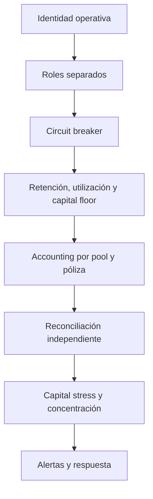

# Política de seguridad

## Versiones mantenidas

| Versión   | Estado      |
| --------- | ----------- |
| `1.0.x`   | Mantenida   |
| `< 1.0.0` | Sin soporte |

## Comunicación responsable

Envía los hallazgos mediante un
[aviso privado de seguridad](https://github.com/SolguardLabs/AegisInsuranceProtocol/security/advisories/new).
No publiques detalles técnicos en issues, pull requests o discusiones antes de disponer de una
corrección coordinada.

Incluye el commit afectado, precondiciones, transición económica, impacto cuantificado, prueba
determinista y propuesta de regresión. No adjuntes claves, endpoints privados ni datos personales.

## Fronteras de confianza

- El owner configura productos, roles, treasury y límites globales.
- El sponsor administra únicamente el estado y los límites de sus pools.
- El guardian puede pausar; solo el owner puede reanudar.
- El router distribuye exposición dentro de retención y capacidad disponibles.
- El keeper valida señales de incidente y ejecuta settlements aprobados.
- El reviewer decide sobre claims, pero no mueve capital directamente.
- Los servicios Python consumen estado on-chain y no son fuente de verdad para balances.
- Oráculos, evidence stores y relayers son entradas no confiables hasta su validación.

## Invariantes económicas

```text
0 <= lockedExposure <= capacityCeiling
capacityCeiling = totalCapital × maxUtilizationBps / 10,000
policy.activeExposure = retainedExposure + Σ cessions
claim.amountPaid <= claim.amountApproved <= claim.amountRequested
```

Además:

- cada cession debe preservar la retención mínima del pool originador;
- una retirada no puede atravesar `lockedExposure` ni `minCapital`;
- cada payout reduce capital, pending claims y exposición en el mismo lote;
- la suma de asignaciones activas debe reconciliar con el ledger agregado por pool;
- los fees de protocolo no forman parte del capital disponible del pool;
- un cambio de estado sensible debe producir un evento reconstruible.

## Capas de control



## Operación segura

- Usa multisig y timelock en la cuenta owner de una integración persistente.
- Separa cuentas de guardian, router, reviewer y keeper.
- Serializa mutaciones por pool y asigna identificadores idempotentes a jobs.
- Verifica exposición y pending claims antes y después de cada lote.
- Pausa compras y retiradas ante gaps contables o incidentes sin consenso.
- Mantén evidence hashes y decisiones en almacenamiento append-only.
- Registra snapshots por epoch y compara contra el toolkit independiente.
- Ancla releases al mismo SHA en `main`, `production` y el tag estable.

## Validación automatizada

```bash
python -m pip install -e ".[dev]"
bash scripts/ci.sh
```

El gate valida compilación Vyper, tamaño de runtime EIP-170, suite Boa, cobertura Python,
compilación de módulos y tamaño de fuente. Para tags `v*`, GitHub Actions comprueba que el tag
coincida con la versión de `pyproject.toml`.

## Cadena de suministro

- Las versiones de Vyper, titanoboa, pytest y pytest-cov están fijadas.
- Dependabot revisa pip y GitHub Actions semanalmente.
- Los workflows reciben permiso de lectura sobre contenidos.
- `.venv`, caches, coberturas, builds y artefactos no se versionan.

## Alcance

Dentro de alcance:

- pricing, deducibles y fees;
- accounting de capital, shares y exposición;
- cessions y asignaciones multipartícipe;
- incidentes, revisión y settlement de claims;
- expiración, retiradas y solvencia;
- roles, pausa, reporting y reconciliación.

Fuera de alcance:

- disponibilidad de proveedores externos;
- custodia de claves de un integrador;
- seguridad del host o del pipeline que consuma el paquete;
- parámetros de riesgo aprobados explícitamente por gobierno.
