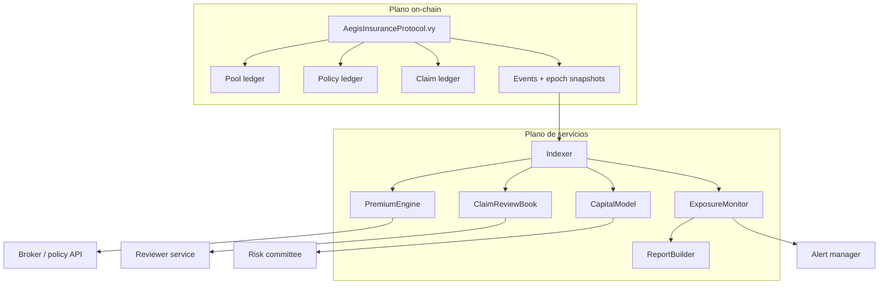
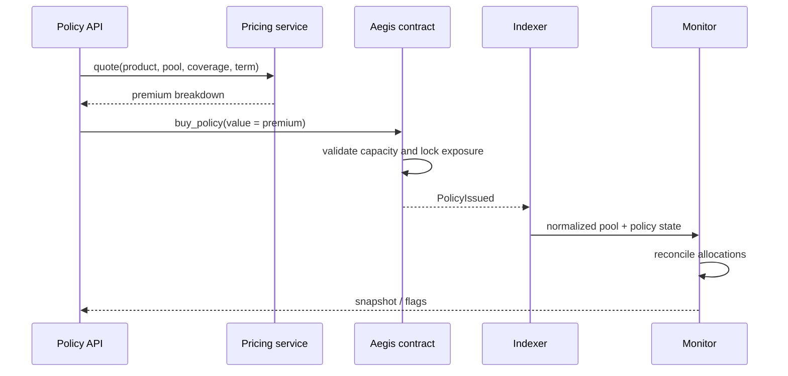

# Arquitectura

## Vista de componentes

## Contrato Vyper

`AegisInsuranceProtocol.vy` concentra las transiciones que afectan a valor:

- alta y límites de pools;
- depósitos y retiradas de capital;
- catálogo de productos;
- compra y expiración de pólizas;
- transferencias de exposición;
- claims, decisiones y pagos;
- roles, pausa y snapshots.

El runtime se compila con optimización por tamaño y CI exige no superar 24.576 bytes, el límite
EIP-170. La analítica que no necesita consenso se mantiene fuera de la EVM.

## Toolkit Python

| Módulo | Responsabilidad |
| --- | --- |
| `models.py` | Objetos inmutables y validación de dominio. |
| `ledger.py` | Réplica operativa de capital, pólizas y posiciones. |
| `pricing.py` | Breakdown reproducible de prima. |
| `claims.py` | Evidencias y recomendación de revisión. |
| `capital_model.py` | Pérdida esperada, correlación y capital requerido. |
| `monitoring.py` | Reconciliación y flags por pool. |
| `reporting.py` | Exportación Markdown y CSV. |
| `scenarios.py` | Escenarios deterministas de integración. |

## Flujo de escritura

## Consistencia

Los consumidores deben ordenar eventos por `(blockNumber, transactionIndex, logIndex)`, aplicar
reorganizaciones antes de publicar snapshots y releer estado del contrato en cada checkpoint. Un
evento no sustituye una lectura finalizada del storage.
