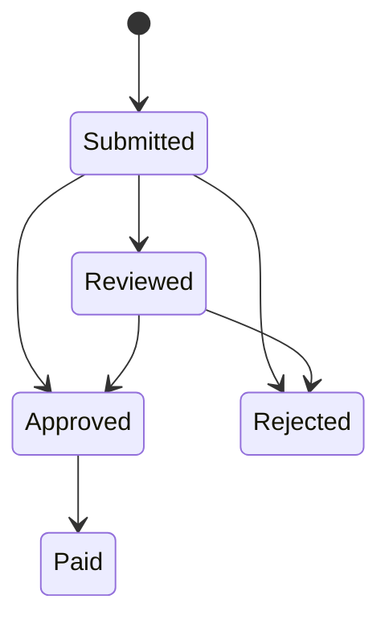

# Claims

## Estados

## Admisión

Un claim requiere:

- póliza existente y activa;
- caller holder o beneficiary;
- ventana de claim abierta;
- importe positivo dentro de cobertura restante;
- señal de incidente activa;
- hashes no ambiguos de incidente y evidencia.

El contrato almacena hashes. Los documentos completos permanecen en un evidence store con
retención, integridad y control de acceso propios.

## Revisión

`ClaimReviewBook` combina términos de producto, evidencia adjunta y señal del incidente para
preparar una recomendación. La decisión on-chain pertenece a un reviewer autorizado.

Separación mínima:

| Acción | Rol |
| --- | --- |
| Activar incidente | Keeper |
| Adjuntar evidencia | Claim service |
| Aprobar/rechazar | Reviewer |
| Ejecutar payout | Keeper |
| Pausar | Guardian u owner |
| Reanudar | Owner |

## Asignación

El requested amount se reparte según la proporción de exposición en el momento de submit. Las
asignaciones quedan fijadas en `claim_pool_id` y `claim_pool_amount`; un cambio posterior de la
póliza no debe reinterpretar un claim ya abierto.

## Settlement

Por cada pool participante:

1. reducir `pending_claims` por exposición asignada;
2. liberar exposición asociada;
3. reducir capital por payout neto;
4. incrementar paid claims;
5. acumular el total pagado.

El último pool absorbe residuos de división. La transacción completa revierte si un pool no puede
cubrir su parte.

## Evidencia operativa

Para cada claim conserva:

- bloque y transaction hash de submit;
- evidence hash y versión del schema;
- fuentes del incidente;
- reviewer, decisión y timestamp;
- allocation table por pool;
- payout bruto, deducible y neto;
- snapshot antes y después de settlement.
