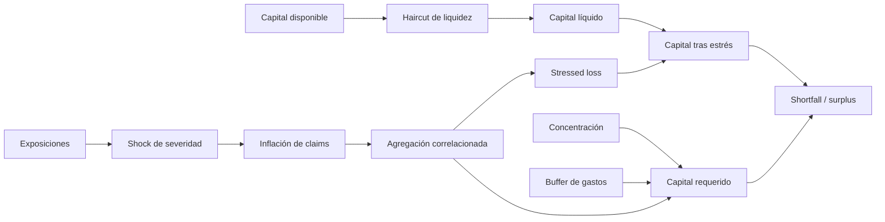

# Modelo económico y capital

## Unidades

El contrato usa wei para capital y cobertura. Los porcentajes se expresan en basis points:

```text
10,000 bps = 100%
100 bps = 1%
```

Todas las divisiones usan truncamiento entero conservador.

## Capacidad de underwriting

Para un pool con capital `C`, utilización máxima `u` y exposición bloqueada `E`:

```text
capacityCeiling = floor(C × u / 10,000)
availableCapacity = max(capacityCeiling - E, 0)
utilizationBps = floor(E × 10,000 / C)
```

Una póliza solo puede emitirse si su cobertura cabe en `availableCapacity`.

## Prima

La prima on-chain separa tiempo y utilización:

```text
timePremium = floor(coverage × baseRateBps × durationDays / 365 / 10,000)
utilizationPremium = floor(coverage × utilizationBps / 10,000 / 25)
grossPremium = max(timePremium + utilizationPremium, minPremium)
protocolFee = floor(grossPremium / 10)
poolPremium = grossPremium - protocolFee
```

El toolkit amplía el quote con scores de riesgo, haircut jurisdiccional y descuento de broker. El
breakdown debe almacenarse junto al quote para poder reproducirlo.

## Deducible y payout

```text
deductible = floor(approvedAmount × deductibleBps / 10,000)
netPayout = approvedAmount - deductible
```

En una póliza sindicada, el request se distribuye proporcionalmente a cada asignación actual. El
último slot absorbe el residuo de redondeo para que la suma sea exacta.

## Pérdida esperada

Para cada celda de exposición `i`:

```text
ELᵢ = exposureᵢ × probabilityᵢ × severityᵢ / 10,000²
EL = Σ ELᵢ
```

`probabilityBps` representa frecuencia en la ventana modelada y `severityBps` la fracción de
exposición perdida cuando el evento ocurre.

## Dependencia entre riesgos

El capital no suma simplemente los máximos independientes. Aegis utiliza una aproximación de
correlación común `ρ`:

```text
standaloneᵢ = exposureᵢ × severityᵢ / 10,000
S = Σ standaloneᵢ
Q = Σ standaloneᵢ²
variance = Q + ρ × (S² - Q) / 10,000
correlatedLoss = floor(√variance)
```

Con `ρ = 0`, las celdas diversifican por raíz cuadrada. Cuando `ρ` se acerca a 10.000 bps, la
pérdida converge hacia la suma lineal.

## Waterfall de estrés



Formalmente:

```text
stressedSeverityᵢ = min(severityᵢ + incidentShockBps, 10,000)
stressedCellᵢ = exposureᵢ × stressedSeverityᵢ / 10,000
stressedCellᵢ = stressedCellᵢ × (10,000 + claimInflationBps) / 10,000
liquidCapital = capital × (10,000 - liquidityHaircutBps) / 10,000
capitalAfterStress = max(liquidCapital - stressedLoss, 0)
requiredCapital = max(expectedLoss, correlatedLoss) + concentrationCharge + expenseBuffer
shortfall = max(requiredCapital - capitalAfterStress, 0)
```

## Ejemplo

Supuestos:

| Celda | Exposición | Probabilidad | Severidad |
| --- | ---: | ---: | ---: |
| Vault estable | 300 | 9% | 60% |
| Bridge | 180 | 6,5% | 45% |
| Operador restaking | 220 | 12% | 75% |

Capital disponible: `1.500`. Escenario: shock de severidad 20%, inflación de claims 12,5%,
haircut de liquidez 7,5% y correlación 35%.

El resultado exacto se obtiene con `CapitalModel.assess`. Para aprobar un cambio de límites se
deben registrar `requiredCapital`, `coverageRatioBps`, `largestSubjectBps` y cualquier `shortfall`.

## Sensibilidades

- `incidentShockBps` captura un evento sistémico común.
- `claimInflationBps` aproxima costes, slippage y desviación del estimate inicial.
- `liquidityHaircutBps` reduce capital inmediatamente realizable.
- `commonCorrelationBps` controla beneficio de diversificación.
- `concentrationChargeBps` penaliza la mayor celda stressed.
- `expenseBufferBps` añade margen operativo sobre la pérdida stressed.
