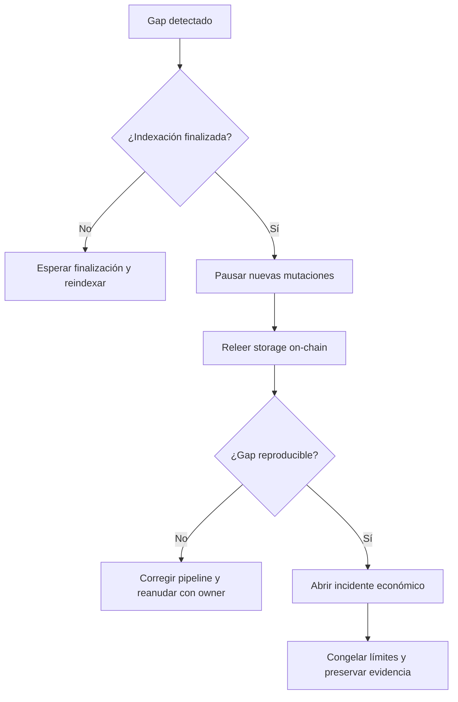

# Operación

## Checklist de arranque

1. Verificar SHA de `main`, `production` y tag desplegable.
2. Ejecutar `scripts/ci.sh` sobre el checkout exacto.
3. Confirmar runtime menor o igual a 24.576 bytes.
4. Validar owner, treasury y roles operativos.
5. Releer productos, pools y límites.
6. Construir snapshot independiente desde eventos finalizados.
7. Reconciliar exposición y claims.
8. Ejecutar escenarios de capital.

## Métricas

| Métrica | Fuente | Alerta inicial |
| --- | --- | ---: |
| `utilization_bps` | Contrato | ≥ 8.000 |
| `solvency_bps` | Contrato | < 12.500 |
| `claim_backlog_bps` | Monitor | > 2.500 |
| `largest_subject_bps` | Monitor | > 4.000 |
| `exposure_gap` | Monitor | > 0 |
| `pending_claim_gap` | Monitor | > 0 |
| `coverage_ratio_bps` | Capital model | < 10.000 |
| `shortfall` | Capital model | > 0 |

Los umbrales son valores de arranque. Deben versionarse por producto y jurisdicción.

## Cadencia

- Por bloque finalizado: eventos y saldos críticos.
- Cada cinco minutos: reconciliación completa de pools activos.
- Cada hora: backlog, concentración y freshness de fuentes.
- Diario: capital base y stress idiosincrático.
- Semanal: escenario sistémico, dependencias y roles.
- Antes de un cambio: simulación y snapshot firmado.

## Runbook de gap contable

No ajustes el ledger off-chain para que coincida manualmente. La corrección debe partir de estado
canónico y una causa identificada.

## Runbook de claim masivo

1. Guardian pausa compras y retiradas.
2. Keeper fija señales de incidente verificadas.
3. Indexer genera allocations y capital por pool.
4. Reviewer procesa claims por lote documentado.
5. Risk committee compara payout con capital líquido.
6. Keeper liquida solo lotes aprobados y reconciliados.
7. Owner reanuda tras snapshot sin gaps.

## Release

Una versión estable requiere:

- suite local correcta;
- PR fusionada con CI verde;
- `production` en el mismo SHA que `main`;
- CI verde de `production`;
- tag `vX.Y.Z` en ese SHA;
- job `Release integrity` correcto;
- release no draft y no prerelease.
