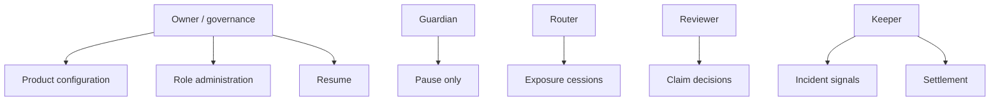

# Riesgo y seguridad

## Matriz de controles

| Riesgo | Preventivo | Detectivo | Respuesta |
| --- | --- | --- | --- |
| Exceso de utilización | `maxUtilizationBps` | `UTILIZATION_HIGH` | Pausar admisión |
| Cesión excesiva | `retentionBps` | Reconciliación por póliza | Revocar router |
| Capital insuficiente | `minCapital` y exposure lock | Capital stress | Recapitalizar pool |
| Datos de incidente falsos | Keeper autorizado | Fuentes y evidence hash | Desactivar señal |
| Decisión de claim indebida | Reviewer separado | Eventos y revisión | Pausa + revocación |
| Drift contable | Límites atómicos | `ExposureMonitor` | Bloquear lote |
| Concentración | Límites de cartera | `SUBJECT_CONCENTRATION_HIGH` | Ceder/no renovar |

## Invariantes de reconciliación

Para cada pool `p`:

```text
derivedExposure[p] = Σ activePolicy.allocation[p]
exposureGap[p] = |recordedExposure[p] - derivedExposure[p]|

derivedPending[p] = Σ openClaim.allocation[p]
pendingGap[p] = |recordedPending[p] - derivedPending[p]|
```

En operación normal ambos gaps deben ser cero. Una tolerancia distinta solo está justificada por
un pipeline con finalización diferida y debe medirse en unidades del activo, no en porcentaje.

## Modelo de roles



Ninguna cuenta operativa debe compartir claves con otra. El owner debe estar protegido por
multisig y proceso de cambio demorado en la capa de gobierno.

## Flags

- `EXPOSURE_MISMATCH`: diferencia entre ledger y pólizas activas.
- `CLAIM_ALLOCATION_MISMATCH`: diferencia entre pending ledger y claims abiertos.
- `UTILIZATION_HIGH`: utilización en o por encima del umbral.
- `SOLVENCY_LOW`: ratio capital/obligaciones inferior al objetivo.
- `CLAIM_BACKLOG_HIGH`: pending claims sobre capital rebasa la política.
- `SUBJECT_CONCENTRATION_HIGH`: la mayor concentración rebasa el límite.

## Acciones automáticas

Solo las acciones reversibles deben automatizarse:

- activar pausa ante gap contable confirmado;
- detener quotes cuando el indexer está atrasado;
- bloquear jobs nuevos para un pool con incident response abierto;
- escalar al risk committee un shortfall.

Cambios de límites, decisiones de claim, movimientos de capital y reanudación requieren autoridad
explícita.
