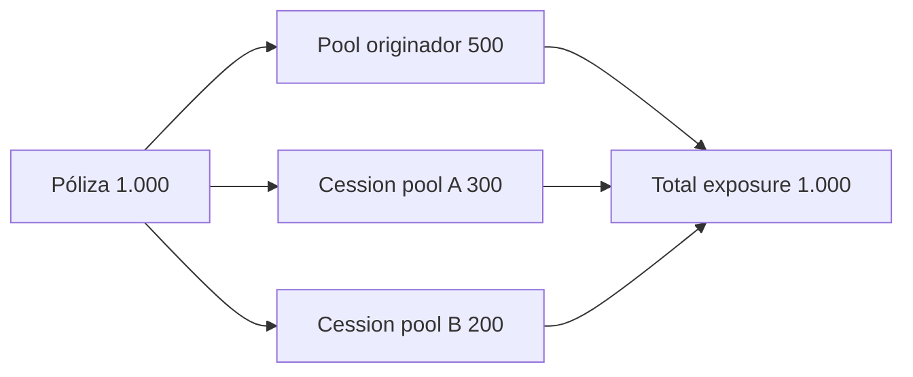

# Underwriting y cesiones

## Risk pools

Cada pool define:

- sponsor y jurisdicción;
- capital mínimo operativo;
- utilización máxima;
- retención mínima por póliza originada;
- capital total, exposición, claims y primas acumuladas;
- estado `active`, `paused` o `inactive`.

`minCapital` no reserva cobertura: es un floor operativo adicional. `maxUtilizationBps` limita
nueva emisión y `retentionBps` impide ceder más riesgo del autorizado.

## Productos

Un producto fija `baseRateBps`, `minPremium`, `deductibleBps`, `claimWindowDays`, `maxCover` y
estado de admisión. Cambiar el producto afecta únicamente a nuevas pólizas; los servicios deben
persistir los términos efectivos de cada emisión.

## Póliza sindicada



Invariantes del router:

```text
retainedExposure + cededExposure = activeExposure
cededExposure = Σ cessionAmount
retainedAfter >= coverage × retentionBps / 10,000
target.availableCapacity >= cessionAmount
```

## Proceso recomendado

1. Leer el estado finalizado de póliza y ambos pools.
2. Calcular retención posterior y capacidad del destino.
3. Simular la transacción sobre un fork o entorno aislado.
4. Enviar `transfer_policy_exposure` desde el router autorizado.
5. Confirmar `PolicyExposureTransferred`.
6. Releer asignaciones y ejecutar `ExposureMonitor`.
7. Alertar si cualquier gap supera la tolerancia configurada.

## Cambios de límites

Antes de modificar utilización o retención:

- ejecutar escenarios base, idiosincrático y sistémico;
- comparar capital requerido con capital líquido;
- revisar concentración por producto, subject y jurisdicción;
- comprobar que ninguna póliza existente queda fuera de política;
- registrar aprobación y parámetros con timestamp efectivo.
